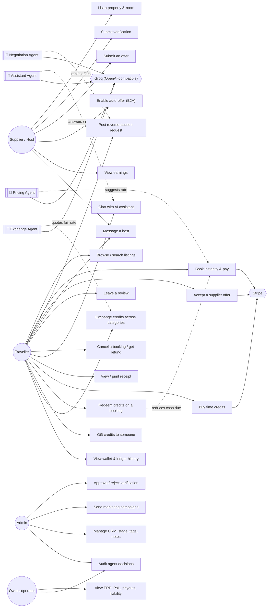
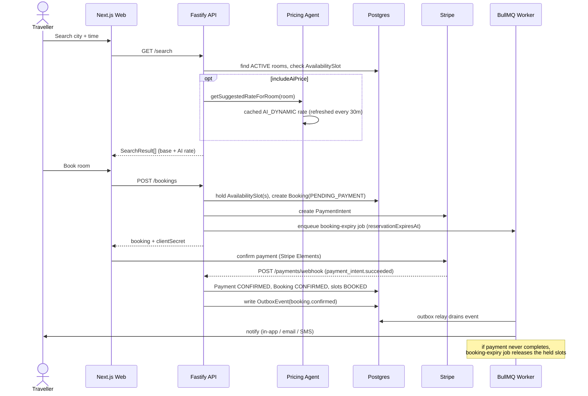
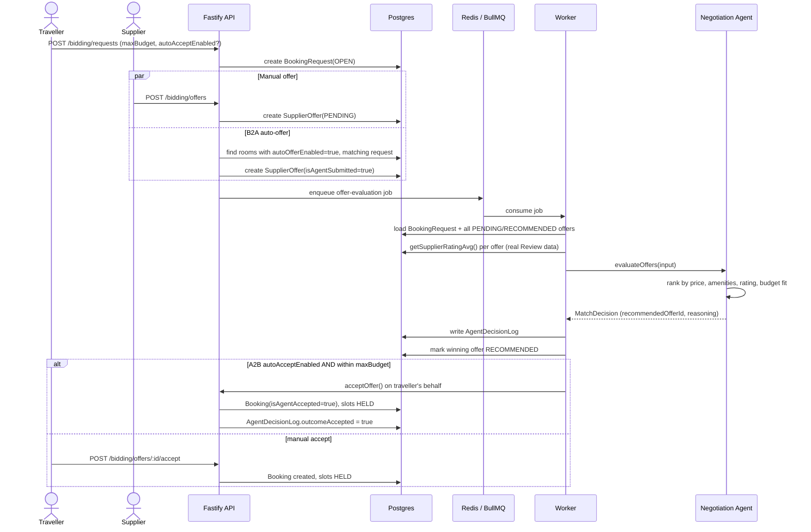
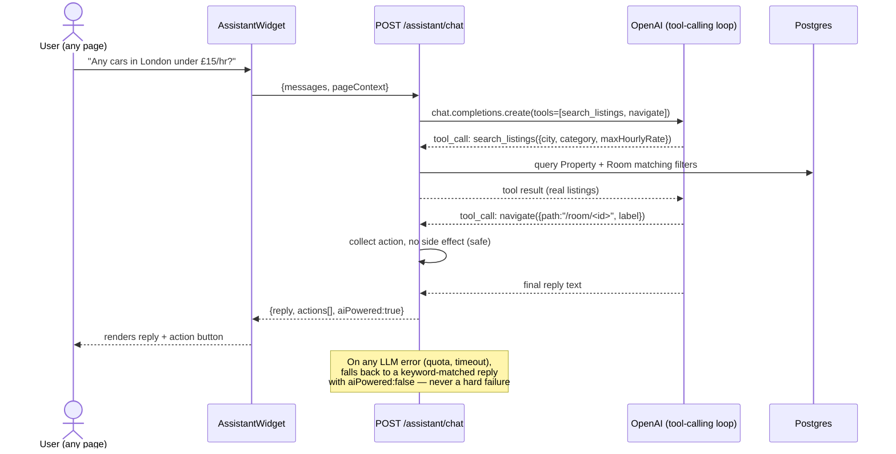
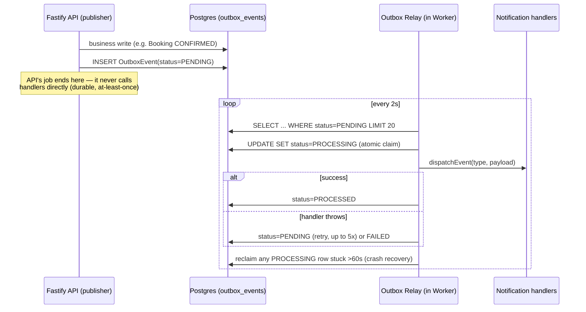
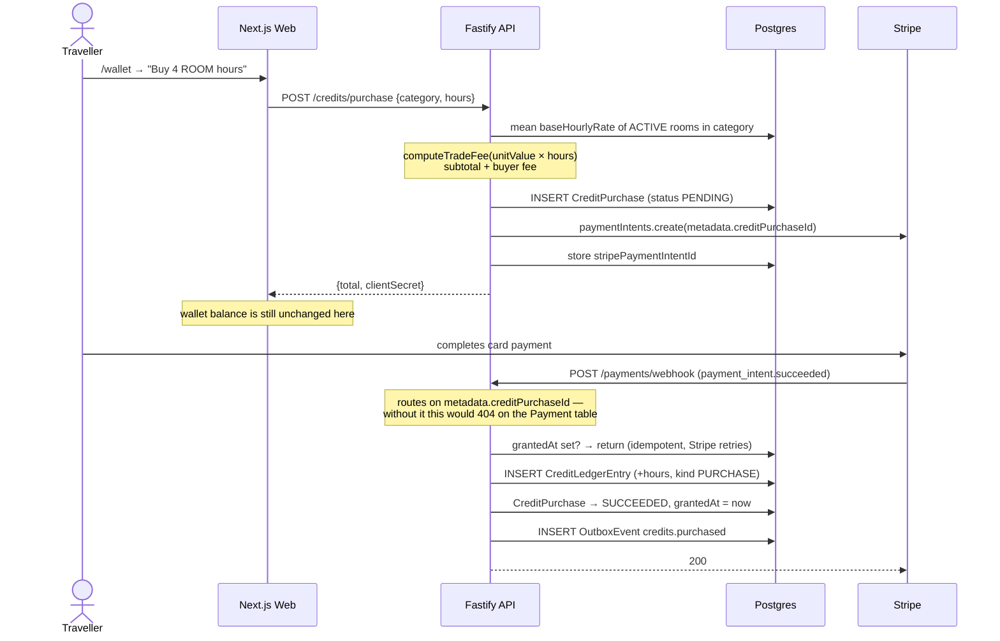
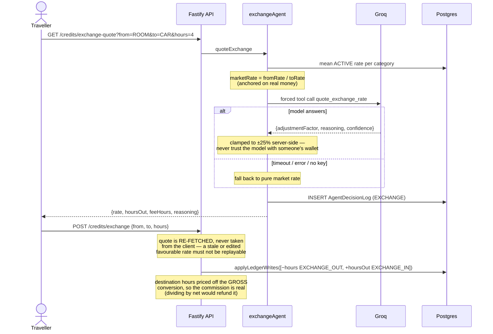
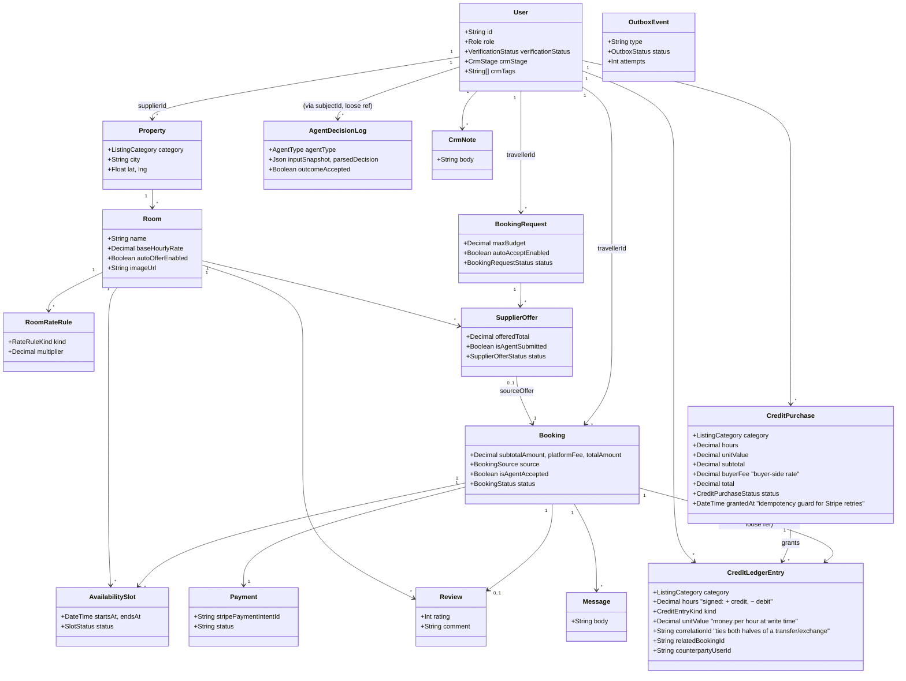
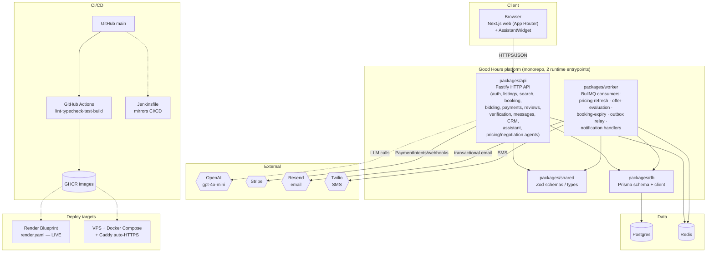

# Diagrams

All diagrams are Mermaid — they render natively on GitHub. Grounded directly
in the current code (module names, routes, Prisma models); update them
alongside the code they describe, not after the fact.

## 1. Use-case diagram

Mermaid has no native UML use-case shape, so this is a flowchart styled as one
(actors on the left/right, use cases in the middle).



Note `Owner-operator` is not a role — it is a single hard-coded email
(`ERP_ADMIN_EMAIL`), enforced server-side by the `requireEmail` guard. Every
other `Admin` is denied the ERP console.

## 2. Sequence: instant booking + payment



## 3. Sequence: reverse-auction (B2A auto-offer → Negotiation Agent → A2B auto-accept)



## 4. Sequence: agentic assistant (tool-calling concierge)



## 5. Sequence: transactional outbox (durable event delivery)



## 6. Sequence: buying time credits (credits granted only on payment)

The wallet is credited from the **webhook**, never from the request that
started checkout — otherwise abandoning payment would hand out free hours.



## 7. Sequence: redeeming credits on a booking

Credits cut the **cash** due. The supplier is still paid in full; the platform
settles the difference from the liability it took on when the hours were sold.

```mermaid
sequenceDiagram
    actor T as Traveller
    participant API as Fastify API
    participant Ledger as credits/ledger
    participant DB as Postgres
    participant S as Stripe

    T->>API: POST /bookings {roomId, times, redeemCreditHours: 4}
    API->>DB: room + availability check
    Note over API: reject if redeem > hours booked —<br/>a credit buys an hour, not a discount
    API->>Ledger: getBalanceFor(user, category)
    API->>DB: hold slots + INSERT Booking<br/>(totalAmount stays GROSS,<br/>creditValueApplied recorded separately)

    API->>Ledger: applyLedgerWrites([-4h REDEEM])
    Note over Ledger: Serializable txn; balance checked<br/>AFTER insert so concurrent spends<br/>cannot both commit
    alt debit loses the race
        Ledger-->>API: 409 INSUFFICIENT_CREDITS
        API->>DB: releaseExpiredReservation (frees slots)
        API-->>T: 409 — nothing charged, nothing held
    else debit succeeds
        Note over API: cashDue = travellerTotal − creditValueApplied
        alt cashDue > 0
            API->>S: paymentIntents.create(cashDue)
            API-->>T: clientSecret → checkout
        else fully credit-funded
            API->>DB: Booking → CONFIRMED, slots → BOOKED
            Note over API: nothing to charge, so don't park it<br/>in PENDING_PAYMENT for the expiry job to kill
            API-->>T: confirmed immediately
        end
    end
```

On cancellation **or** unpaid expiry, `refundRedeemedCredits(bookingId)` returns
the hours (idempotent — it no-ops if a REFUND row already exists).

## 8. Sequence: exchanging credits across categories



## 9. Class diagram — core domain model



`CreditLedgerEntry` is **append-only and has no balance column** — a balance is
always `SUM(hours)` for a `(userId, category)` pair. Nothing in that table is
ever updated or deleted; corrections are new rows.

`Booking.creditHoursRedeemed` / `creditValueApplied` record what credits
covered. `totalAmount` stays **gross** so receipts, CRM lifetime spend and ERP
revenue keep their existing meaning; the cash actually charged lives on
`Payment.amount`.

## 10. Software architecture (container view)



## Notes on accuracy

- The worker imports several `api` module files by relative path (same
  codebase, second entrypoint) rather than a published package boundary —
  see `docs/ARCHITECTURE.md`.
- The assistant's tool set today is `search_listings` and `navigate` only —
  it never mutates data (no booking/payment tool), by design (see
  `docs/AGENT_DECISIONS.md` and the security note in
  `packages/api/src/modules/assistant/service.ts`).
- Diagram 5 (outbox) replaced a plain in-process `EventEmitter`; see
  `packages/api/src/events/relay.ts`.
